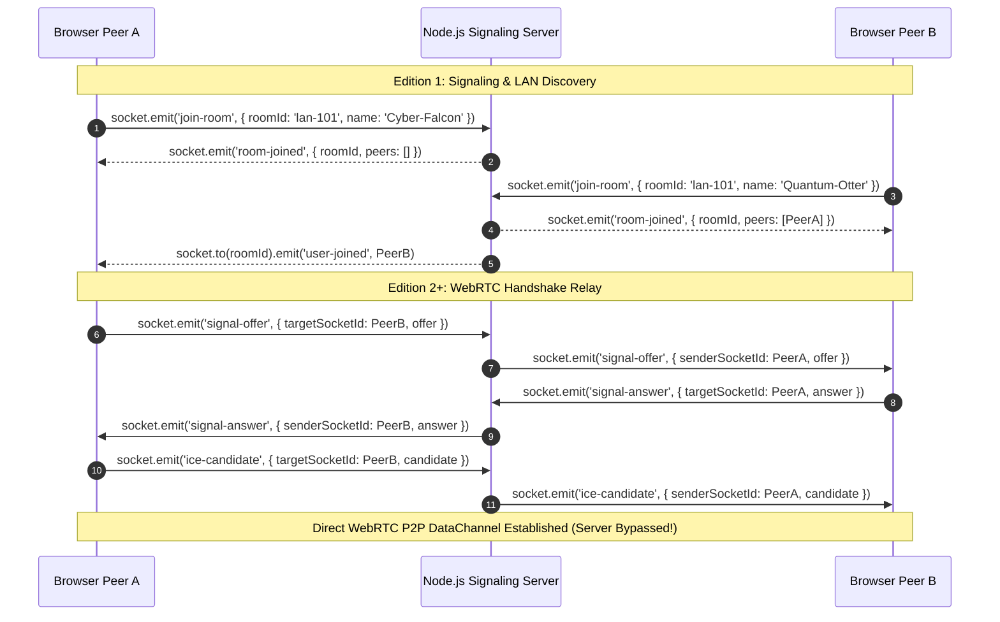

# 🚀 PeerVault AI (Edition 1)
### *AI-Powered LAN Peer-to-Peer End-to-End Encrypted File Sharing & Intelligence System*


---

## 📌 Executive Summary & Abstract

**PeerVault AI** is a zero-cloud, browser-native local file sharing tool built for high-throughput, private peer-to-peer data transfers over Local Area Networks (LAN). 

Unlike cloud storage solutions (Google Drive, Dropbox) that require uploading files to third-party servers, **PeerVault AI** establishes direct browser-to-browser WebRTC data pipes. Files travel strictly across the local Wi-Fi network without touching any external cloud server or intermediate database.

This repository represents **Edition 1** of a granular **8-Edition 4th-Year Computer Science & Engineering (CSE) Capstone Project**.

---

## 🏗️ System Architecture & Signaling Flow

In WebRTC architecture, browsers cannot connect directly without first discovering each other's IP address, port, and network NAT capabilities. The Node.js server serves exclusively as an **ephemeral signaling broker**.

```
+-----------------------------------------------------------------------------------+
|                                 LOCAL LAN NETWORK                                 |
|                                                                                   |
|   +-----------------------+                             +---------------------+   |
|   |  Browser Peer A       |                             |  Browser Peer B     |   |
|   |  (Initiator)          |                             |  (Receiver)         |   |
|   +-----------+-----------+                             +----------+----------+   |
|               |                                                    |              |
|               | 1. Join Room (Socket.io)                           |              |
|               | 2. Exchange SDP Offer / Answer                     |              |
|               | 3. Exchange ICE Candidates                         |              |
|               v                                                    v              |
|   +---------------------------------------------------------------------------+   |
|   |                    Node.js Express + Socket.io Server                     |   |
|   |                           (Signaling Server)                              |   |
|   |   - Auto LAN IP Detection          - Ephemeral Room Management            |   |
|   |   - SDP Offer/Answer Relay         - ICE Candidate Relay                  |   |
|   +---------------------------------------------------------------------------+   |
|                                                                                   |
|  ==============================================================================   |
|                   FUTURE EDITIONS: DIRECT WEBRTC P2P DATA PIPE                    |
|   [ Browser A ] <=============================================> [ Browser B ]    |
|                        Direct RTCDataChannel (SCTP/UDP)                           |
+-----------------------------------------------------------------------------------+
```

---

## 📑 WebRTC Protocol Sequence Diagram



---

## 🛠️ Technology Stack Breakdown

| Layer | Technology | Purpose |
| :--- | :--- | :--- |
| **Server Runtime** | Node.js (v18+) | Ephemeral HTTP & WebSocket Server execution |
| **Server Framework** | Express.js | Static asset delivery and CORS handling |
| **Signaling Engine** | Socket.io (v4.7) | Event-driven real-time WebSocket protocol |
| **Transport Layer** | WebRTC (`RTCDataChannel`) | High-throughput browser-to-browser P2P transport |
| **Client UI** | HTML5, Modern CSS3 | Glassmorphism UI, glowing indicators, responsive grid |
| **Client Logic** | Vanilla JavaScript (ES6+) | Socket lifecycle events, room state, event logging |

---

## 🗺️ 8-Edition Granular Project Roadmap

| Edition | Stage | Status | Features Included |
| :---: | :--- | :---: | :--- |
| **01** | **Signaling & LAN Discovery** | **✅ Completed** | Node.js Socket.io server, LAN IP detection, Room management UI, Event logger |
| **02** | **WebRTC P2P DataPipe** | ⏳ Next | `RTCPeerConnection` setup, SDP offer/answer relay, P2P Text Chat UI |
| **03** | **Single-Buffer File Transfer** | 📋 Planned | File Picker, `FileReader.readAsArrayBuffer()`, Blob auto-download |
| **04** | **Chunking & Flow Control** | 📋 Planned | 64KB binary chunking, `bufferedAmount` backpressure management for GB files |
| **05** | **LAN Auto-Discovery & Stats UI** | 📋 Planned | Subnet grouping, auto codenames/avatars, real-time speed (MB/s) & ETA |
| **06** | **ECDH Key Exchange** | 📋 Planned | Web Crypto API `ECDH P-256` key derivation, Security fingerprint display |
| **07** | **Client-Side E2E Encryption** | 📋 Planned | `AES-GCM-256` chunk encryption, unique 12-byte IVs, zero-knowledge lock badge |
| **08** | **AI Integration & Academic Report**| 📋 Planned | Local AI Document Summarizer, File Q&A, AI Bandwidth Optimizer, Final Report & DFDs |

---

## ⚡ Quick Start & Installation

### Prerequisites
- [Node.js](https://nodejs.org/) (v18.0.0 or higher)
- npm (v9.0.0 or higher)
- Devices connected to the same Local Area Network (Wi-Fi or Ethernet)

### 1. Clone Repository
```bash
git clone https://github.com/YOUR_USERNAME/peervault-ai.git
cd peervault-ai
```

### 2. Install Dependencies
```bash
npm install
```

### 3. Launch Server
```bash
npm start
```
*For automatic server reloading during development:*
```bash
npm run dev
```

### 4. Access Application
- **Local Host**: `http://localhost:3000`
- **LAN Access (Mobile/Tablet)**: `http://<YOUR_LAN_IP>:3000` *(IP is printed in terminal log upon server startup)*

---

## 📂 Repository File Structure

```
peervault-ai/
├── public/
│   ├── index.html       # Glassmorphism Dashboard & Room Controls
│   ├── style.css        # Premium Dark Design System & Glowing Effects
│   └── app.js           # Socket.io Client Connection & Event Handlers
├── server.js            # Node.js Express + Socket.io Signaling Server
├── package.json         # Project Metadata & Dependencies
├── package-lock.json    # Dependency Lockfile
├── .gitignore           # Git Exclusion rules (node_modules, logs)
└── README.md            # Comprehensive Project Documentation
```

---

## 🎓 Faculty Viva & Project Evaluation Guide

### Key Questions & Model Answers for Viva Evaluation:

#### 1. Why is Signaling required in WebRTC if data is transferred P2P?
> **Answer:** Browsers operate behind NATs and firewalls. They cannot discover each other's IP address or UDP/TCP ports automatically. The signaling server acts as an initial matchmaker to exchange Session Description Protocol (SDP) metadata and Interactive Connectivity Establishment (ICE) candidates. Once the connection opens, signaling stops.

#### 2. How does the server handle LAN IP discovery?
> **Answer:** In `server.js`, we query `os.networkInterfaces()` to extract non-internal IPv4 addresses assigned by the local Wi-Fi router. This allows devices on the same subnet to access `http://<LAN_IP>:3000`.

#### 3. Does the signaling server have access to files or private chat?
> **Answer:** No. In Edition 1, the server handles only room events (`join-room`). In subsequent editions, binary file chunks are encrypted on the client side using `AES-GCM-256` and travel strictly via `RTCDataChannel`.

---

## 📜 License
This project is licensed under the **MIT License** - see the `LICENSE` file for details.

---

### 👨‍💻 Author & Academic Project Info
- **Project Name:** PeerVault AI
- **Course:** B.Tech Computer Science & Engineering (4th Year Capstone)
- **Domain:** Computer Networks, WebRTC Protocol, End-to-End Cryptography, Web AI
